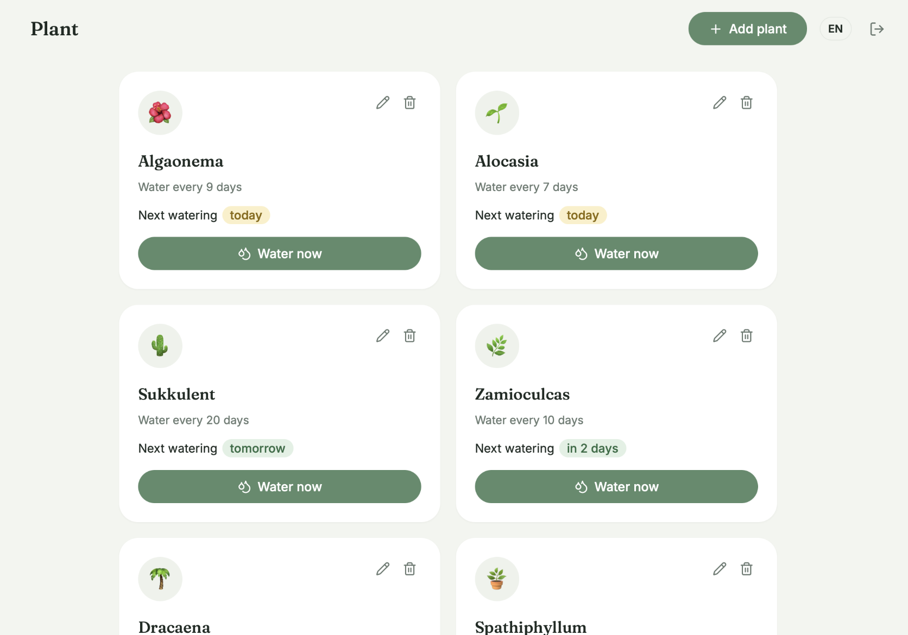
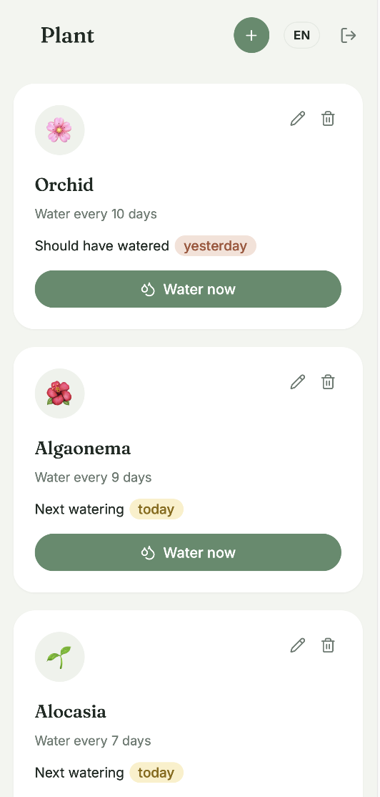

# 🪴 Plant Water Tracker

Set how often each plant needs water, and the app lets you know when it’s time.

**[Live demo →](https://plant-water-tracker.onrender.com)**

> The demo is hosted on a free plan, so the first load may take up to a minute. Please wait a moment.

<table>
  <tr>
    <td align="center">
      <br>
      <sub>Desktop</sub>
    </td>
    <td align="center">
      <br>
      <sub>Mobile</sub>
    </td>
  </tr>
</table>

## Features

- Sign up and log in with form validation
- Protected routes (authenticated users only)
- Add, edit, and delete plants
- Press "Water now" to update the last watering date and recalculate the next one
- Watering status for each plant: on track, due today, or overdue
- Plants sorted by watering urgency
- Switch between RU and EN without reloading the page

## Tech stack

- React, React Router, TypeScript
- TanStack Query: API requests and caching
- react-i18next: internationalization
- Zod: validation shared by client and server
- Vite: build tool
- Express: REST API with cookie-based sessions
- SQLite (better-sqlite3): database

## Getting started

```bash
git clone https://github.com/svetautk/plant_water_tracker.git
cd plant_water_tracker
npm install
```

Then run the server and the client in two separate terminals:

```bash
npm run dev:server   # API on localhost:3000
npm run dev:client   # app on localhost:5173
```
